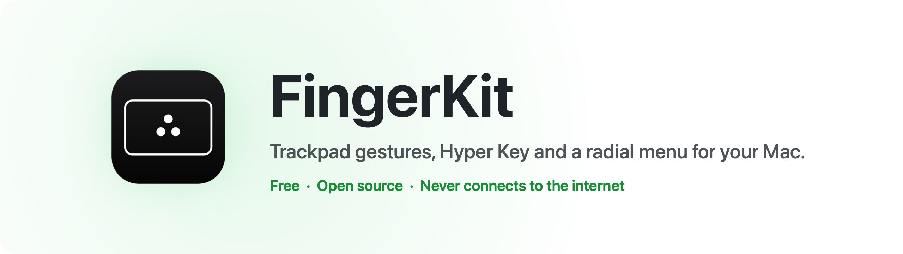
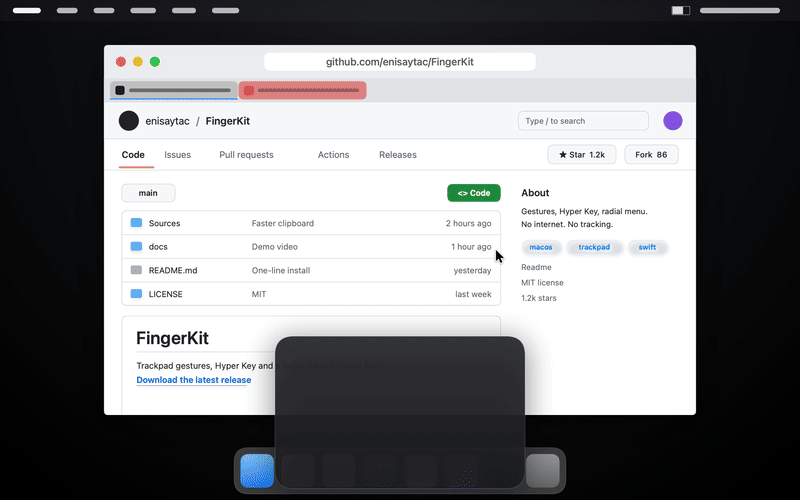
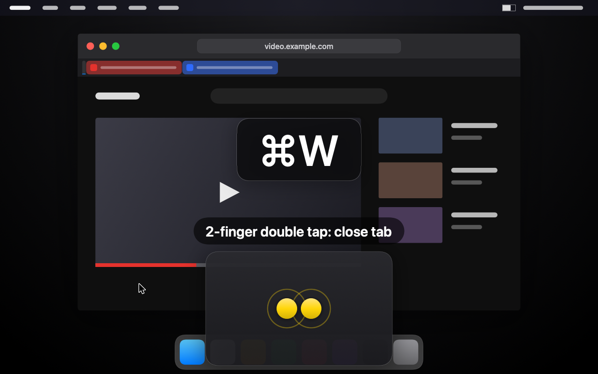
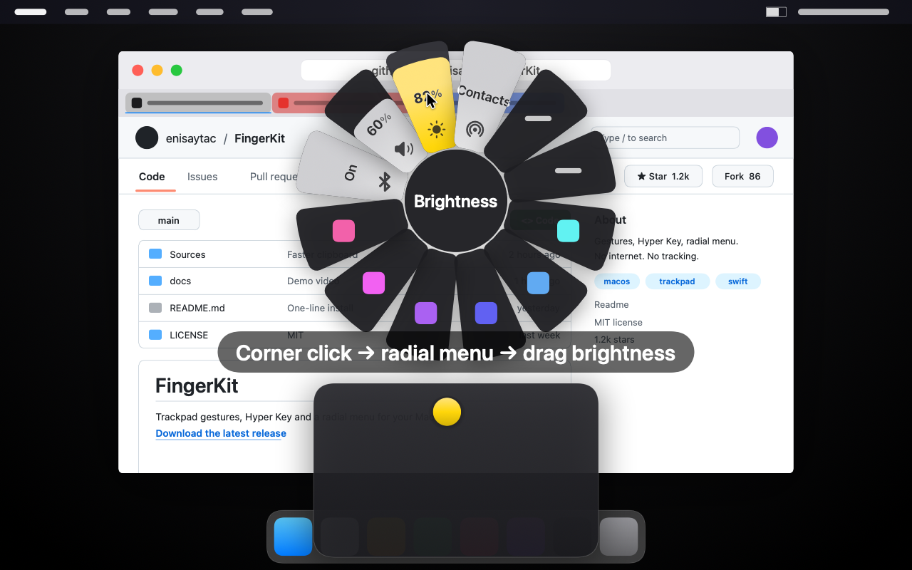
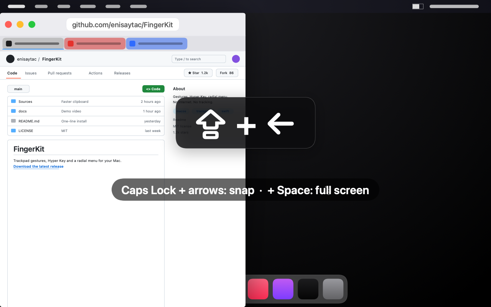
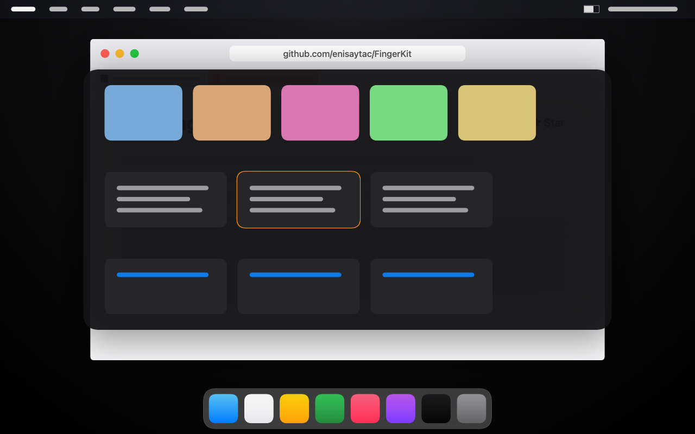
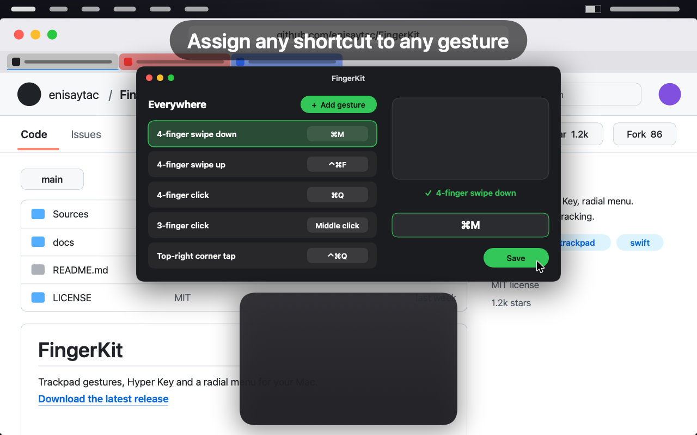
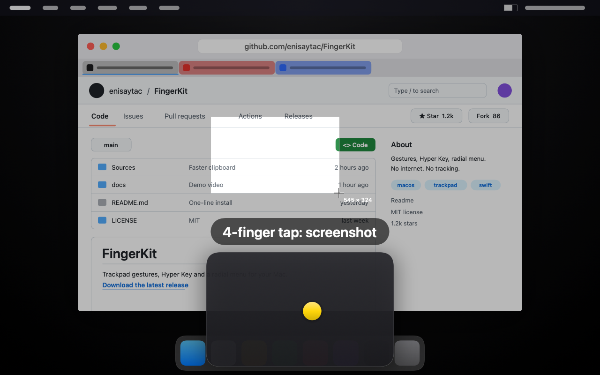

<p align="center">
  <picture>
    <source media="(prefers-color-scheme: dark)" srcset="docs/images/banner-dark.png">
    
  </picture>
</p>

<p align="center">
  <b>Free, open-source trackpad gestures, Hyper Key, window snapping, clipboard history and a radial menu for macOS.</b><br>
  One small menu bar app. No account, no subscription, no tracking.
</p>

<p align="center">
  <a href="https://github.com/enisaytac/FingerKit/releases/latest"></a>
  
  
  
  <a href="LICENSE"></a>
  <a href="https://github.com/enisaytac/FingerKit/actions"></a>
</p>

<p align="center">
  <a href="#install">Install</a> ·
  <a href="#features">Features</a> ·
  <a href="#privacy">Privacy</a> ·
  <a href="#faq">FAQ</a> ·
  <a href="#türkçe">Türkçe</a>
</p>

<p align="center">
  <a href="docs/fingerkit-tanitim.mp4"></a>
</p>

```sh
brew install --cask enisaytac/tap/fingerkit
```

## Features

<table>
<tr>
<td width="50%" valign="top">

<h3>Trackpad gestures</h3>
3, 4 and 5-finger swipes, clicks and taps, double taps, TipTap, edge swipes and corner taps. Each one sends any shortcut or click, everywhere or only in the app you choose.
</td>
<td width="50%" valign="top">

<h3>Radial menu</h3>
Click the bottom-left corner of the trackpad and a circle opens at the pointer: brightness, volume, Bluetooth, your most used apps and the front app's best shortcuts.
</td>
</tr>
<tr>
<td width="50%" valign="top">

<h3>Hyper Key and window snapping</h3>
Caps Lock + any key becomes ⌘⌥⌃⇧ at once, so you get a whole new set of shortcuts. Caps Lock + arrows snaps windows, + Space fills the screen, + a letter opens an app.
</td>
<td width="50%" valign="top">

<h3>Clipboard history</h3>
Caps Lock + V opens your last 50 copies next to the pointer. Type to filter, press 1-9 to paste. Stays on your Mac; password manager copies are never saved.
</td>
</tr>
<tr>
<td width="50%" valign="top">

<h3>Your gestures, your shortcuts</h3>
Press Add gesture, do the gesture on the trackpad, press the shortcut. Done. FingerKit warns you when a gesture clashes with one of macOS's own.
</td>
<td width="50%" valign="top">

<h3>Start empty, add what you like</h3>
A 4-finger tap for a screenshot, a 3-finger click to open links in a new tab: every page shows the settings Mac users share most, each with a small animated preview. One click adds it.
</td>
</tr>
</table>

<details>
<summary><b>Full feature list</b></summary>

**Trackpad gestures**
- 3, 4 and 5-finger swipes, clicks and taps, 2 and 3-finger double taps, TipTap left/right
- Swipe in from an edge, tap a corner
- Each gesture sends any keyboard shortcut or mouse click (⌘-click, right-click, middle click…)
- Different gestures per app, with an "Everywhere" list as the fallback
- Live trackpad view that shows what FingerKit recognized
- Warns when a gesture clashes with one of macOS's own trackpad gestures

**Hyper Key**
- Caps Lock + another key becomes ⌘⌥⌃⇧ all at once; Caps Lock alone still works as before
- Hyper + letter opens an app
- Hyper + arrow snaps the front window to a half of the screen, Hyper + Space fills the screen
- Hold Caps Lock and move your finger to drag the window under the pointer, no click needed

**Clipboard history**
- Keeps your last 50 copied texts
- Hyper + V opens the list next to the pointer; type to filter, press 1-9 to paste

**App shortcuts**
- Remap a key combination in one app only: send another shortcut, or pick an item from that app's menu

**Radial menu**
- Click the bottom-left corner of the trackpad: a circle opens at the pointer
- Bottom half: the apps you use most; top half: system controls and the most useful shortcuts of the front app

**Community favorites**
- Every page starts with a few of the settings Mac users share most, each with a small animated preview
- One click adds it; you start with an empty app and pick only what you like

</details>

**Languages:** English, Türkçe, Deutsch, Español, Français, Português (Brasil), 简体中文, 日本語. FingerKit follows your Mac's language.

## Install

### Homebrew

```sh
brew install --cask enisaytac/tap/fingerkit
```

### Download

1. Download `FingerKit-x.y.z.zip` from the [latest release](https://github.com/enisaytac/FingerKit/releases/latest) and unzip it.
2. Move `FingerKit.app` to your **Applications** folder.
3. Open it. macOS says it can't verify the developer: click **Done**.
4. Go to **System Settings › Privacy & Security**, scroll down and click **Open Anyway** next to FingerKit. You only do this once.

FingerKit is not notarized by Apple (that needs a paid developer account), so macOS shows this warning. The source code is all here; you can also [build it yourself](#build-from-source).
If macOS says the app "is damaged", run this once in Terminal instead:

```sh
xattr -dr com.apple.quarantine /Applications/FingerKit.app
```

### Permissions

| Permission | Why | Needed? |
|---|---|---|
| **Accessibility** | To read the trackpad and send shortcuts and clicks | Yes |
| **Full Disk Access** | Only to read your Screen Time record, so the radial menu can show your most used apps | Optional; without it the Dock order is used |

FingerKit shows a card with a button for each permission. After an update, macOS may ask for Accessibility again: remove FingerKit from the list in System Settings › Privacy & Security › Accessibility and add it back.

## Privacy

- FingerKit makes **no network connections**. Nothing is sent anywhere.
- Settings live in `~/Library/Application Support/FingerKit/`.
- Clipboard history is stored in the same folder, on your Mac only. Copies that password managers mark as private are never saved. You can turn clipboard history off or delete it at any time.

## Requirements

- macOS 15 Sequoia or later
- A Mac with a built-in trackpad or a Magic Trackpad

FingerKit reads the trackpad through `MultitouchSupport`, a private macOS framework that many trackpad tools use. That's why it can't be in the Mac App Store.

## FAQ

**Does it work with a Magic Trackpad?**
Yes, with the built-in trackpad of a MacBook and with a Magic Trackpad.

**Why does macOS warn me when I first open it?**
FingerKit is not notarized by Apple, which needs a paid developer account. See [Download](#download) for the one-time **Open Anyway** step. All the code is here, and you can [build it yourself](#build-from-source).

**Will it break my macOS gestures?**
No. Your system gestures keep working. If you add a gesture that macOS already uses, FingerKit warns you and tells you which macOS gesture it is.

**Does it send anything to the internet?**
No. FingerKit makes no network connections at all, not even to check for updates. The "Check for updates" button only opens the releases page in your browser.

**How do I uninstall it?**
Quit FingerKit from the menu bar, move it to the Trash and delete `~/Library/Application Support/FingerKit/`. With Homebrew: `brew uninstall --zap fingerkit`.

## Build from source

You need Swift 6.1 (Xcode 16.3+ or the Command Line Tools).

```sh
git clone https://github.com/enisaytac/FingerKit.git
cd FingerKit
swift test          # run the tests
./yap.sh            # build, sign with a local certificate, install to /Applications and open
./yap.sh --surum    # build the universal release zip (Apple Silicon + Intel)
```

`yap.sh` creates a local signing certificate the first time, so macOS keeps your Accessibility permission across rebuilds.

## Contributing

Bug reports, ideas and pull requests are welcome. See [CONTRIBUTING.md](CONTRIBUTING.md).
**Translations** were made with AI help and may have mistakes: corrections from native speakers are especially welcome (`Paket/Diller/<language>.lproj/Localizable.strings`).

## Acknowledgements and disclaimer

FingerKit is an independent project. It is not affiliated with or endorsed by Apple, or by the makers of BetterTouchTool or any other app. All trademarks belong to their owners.

Released under the [MIT License](LICENSE): free to use, change and share, provided "as is", without warranty.

---

## Türkçe

**FingerKit**, Mac için ücretsiz ve açık kaynak bir menü çubuğu uygulaması: trackpad hareketleri, Hyper Key, pencere yaslama, pano geçmişi ve daire menü. Hesap yok, abonelik yok, veri toplama yok.

**Neler yapar**
- **Trackpad hareketleri:** 3, 4, 5 parmakla kaydırma, tıklama, dokunma; çift dokunma, TipTap, kenardan kaydırma, köşeye dokunma. Her hareket istediğin kısayolu ya da tıklamayı gönderir; uygulamaya göre farklı hareketler.
- **Hyper Key:** Caps Lock + tuş = ⌘⌥⌃⇧. Hyper + harf uygulama açar, Hyper + ok pencereyi ekranın yarısına yaslar, Caps Lock basılıyken parmağını kaydırınca pencere taşınır.
- **Pano geçmişi:** son 50 kopya; Hyper + V imlecin yanında listeyi açar.
- **Uygulama kısayolları:** bir tuş birleşimi yalnız seçtiğin uygulamada başka iş yapar.
- **Daire menü:** trackpad'in sol alt köşesine tıkla; altta en çok kullandığın uygulamalar, üstte parlaklık, ses, Bluetooth ve öndeki uygulamanın kısayolları.
- **Kendi hareketin:** "Add gesture"a bas, hareketi trackpad'de yap, kısayola bas; bitti.
- **Topluluğun sevdiği ayarlar:** her sayfada Mac kullanıcılarının en çok paylaştığı ayarlar, ne yaptığını gösteren küçük hareketli örnekle; tek tıkla eklenir. Uygulama boş başlar, yalnız beğendiğini eklersin.


**Kurulum:** `brew install --cask enisaytac/tap/fingerkit` ya da [son sürümden](https://github.com/enisaytac/FingerKit/releases/latest) zip'i indir, `FingerKit.app`'i **Uygulamalar** klasörüne taşı ve aç. macOS "geliştirici doğrulanamadı" derse **Bitti**'ye bas, sonra **Sistem Ayarları › Gizlilik ve Güvenlik**'te aşağı inip FingerKit'in yanındaki **Yine de Aç**'a tıkla (yalnız ilk sefer). Apple'ın ücretli onayı olmadığı için bu uyarı çıkar; kodun tamamı burada.

**İzinler:** Erişilebilirlik (zorunlu: trackpad'i okumak ve kısayol göndermek için), Tam Disk Erişimi (isteğe bağlı: yalnız daire menüde en çok kullandığın uygulamaları görmek için).

**Gizlilik:** FingerKit internete hiç bağlanmaz. Ayarlar ve pano geçmişi yalnız senin Mac'inde, `~/Library/Application Support/FingerKit/` klasöründe durur. Şifre yöneticilerinin gizli işaretlediği kopyalar kaydedilmez.

**Sık sorulanlar**
- *Magic Trackpad'le çalışır mı?* Evet, MacBook'un kendi trackpad'iyle de.
- *macOS'un kendi hareketlerini bozar mı?* Hayır. macOS'un kullandığı bir hareketi eklersen FingerKit uyarır ve hangi hareketle çakıştığını söyler.
- *Nasıl kaldırılır?* Menü çubuğundan çık, uygulamayı çöpe at, `~/Library/Application Support/FingerKit/` klasörünü sil. Homebrew ile: `brew uninstall --zap fingerkit`.

Uygulama Mac'in diline göre Türkçe ya da diğer 7 dilden biriyle açılır. Hata bildirimi ve önerileri [Issues](https://github.com/enisaytac/FingerKit/issues) bölümüne Türkçe de yazabilirsin.
